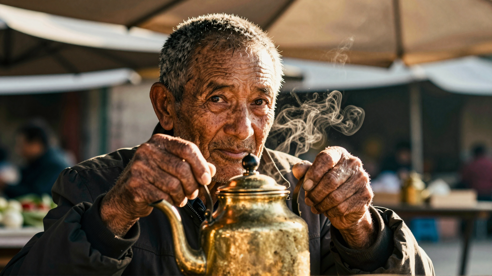

# Local text-to-image generation with ComfyUI

As a BCA cybersecurity student, I used ComfyUI to explore how a text prompt becomes an image on my own computer. The workflow screenshot shows a 1920 × 1080 generated portrait of a market vendor holding a brass kettle. This project demonstrates running an existing model, not training one.

## How the workflow works

The Qwen text encoder converts the market-scene prompt into conditioning for the sampler. The graph routes this to the positive input and sends a zeroed copy to the negative input. The Z-Image-Turbo model, configured with an AuraFlow shift of 3, samples an empty 1920 × 1080 latent. The VAE decoder turns that result into pixels, and Save Image writes the output with the prefix `z-image-turbo`.

## Settings from `Image-Generation.json`

| Setting | Exported value |
|---|---|
| Selected diffusion model | `z_image_turbo_bf16.safetensors` |
| Text encoder | `qwen_3_4b_fp8_mixed.safetensors`, loader type `lumina2` |
| VAE | `ae.safetensors` |
| Image size and batch | 1920 × 1080, one image |
| Sampler and scheduler | `res_multistep`, `simple` |
| Steps, CFG, denoise | 8, 1, 1 |
| Seed used for the included PNG | `593401033992671`, confirmed in the PNG's embedded generation record; control after generation: `randomize` |

## Rerun notes

1. Open `Image-Generation.json` in ComfyUI. Check that the three selected model filenames above are available in the diffusion model, text encoder, and VAE loaders respectively. The diffusion loader's embedded download hint names an INT8 file; it is not the BF16 file selected in the workflow.
2. Keep the exported prompt and sampler settings unchanged for a baseline run. Enter `593401033992671` and switch seed control to `fixed` to hold the noise seed constant.
3. Run once and keep the original PNG. For a follow-up experiment, change one setting, keep the seed fixed, and compare the two outputs. Report elapsed time and VRAM only if measured.

## Evidence and limits

The [original generated PNG](z-image-turbo_00027.png) retains ComfyUI's embedded generation record. Its prompt, model selection, resolution, sampler settings, and seed match the [exported workflow](Image-Generation.json). The [workflow screenshot](workflow-screenshot.png) shows the portrait in the Save Image preview. A second run, runtime, and peak VRAM have not been verified.

